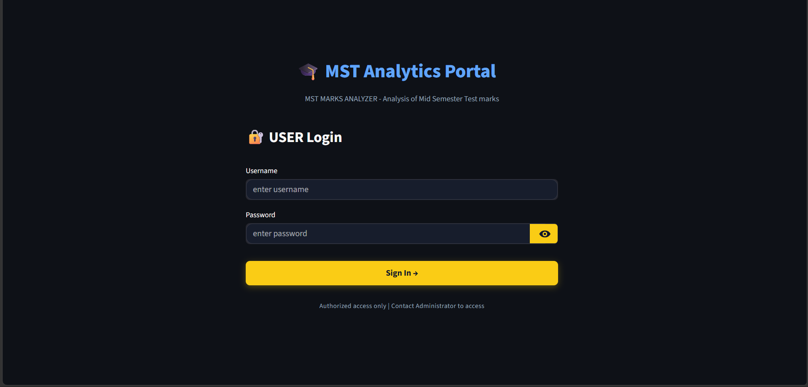
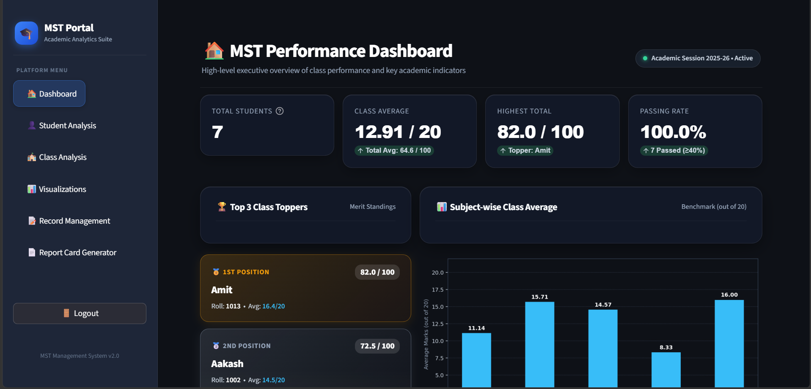
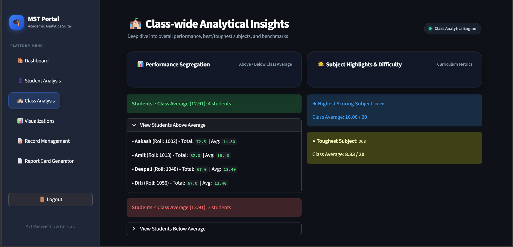
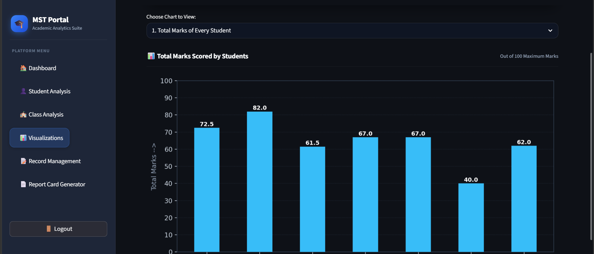
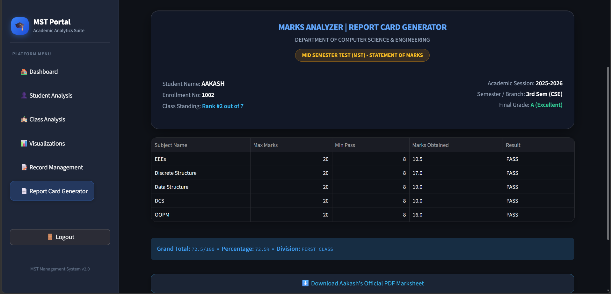

# 📊 MST Marks Analyzer

Student Performance Analytics & Management System
A web-based Student Marks Management and Academic Performance Analysis System built using Python, Streamlit, Pandas, and PostgreSQL.

The application helps manage student MST records, analyze academic performance, and generate useful insights through interactive visualizations.

## 🚀 Features

- **Student Management (CRUD):** Add, update, view, and delete student records.
- **Centralized Database:** Store student records in Supabase PostgreSQL.
- **Performance Analysis:** Calculate total marks, averages, and academic performance.
- **Data Visualization:** Interactive charts and graphical insights.
- **PDF Reports:** Generate student performance reports.
- **CSV Export:** Download master student records.
- **Streamlit Interface:** User-friendly web-based dashboard.
- **Database Integration:** SQLAlchemy for PostgreSQL connectivity.

## 🛠️ Tech Stack

| Technology | Purpose |
|---|---|
| Python | Core programming |
| Streamlit | Web application |
| Pandas & NumPy | Data processing |
| Matplotlib | Data visualization |
| PostgreSQL | Database |
| Supabase | Cloud database hosting |
| SQLAlchemy | Database connectivity |
| ReportLab | PDF generation |

## 📁 Project Structure

```text
MST-Marks-Analyzer/
│
├── app.py
├── data.py
├── analysis.py
├── visualization.py
├── manage_records.py
├── generate_report.py
├── main.py
├── requirements.txt
├── .gitignore
└── README.md
```

## ⚙️ Installation & Setup

### 1. Clone the repository

```bash
git clone YOUR_REPOSITORY_URL
cd MST-Marks-Analyzer
```

### 2. Create a virtual environment

```bash
python -m venv venv
```

Activate it:

**Windows:**
```bash
venv\Scripts\activate
```

### 3. Install dependencies

```bash
pip install -r requirements.txt
```

### 4. Configure database connection

Create a `db.env` file in the project root:

```env
DATABASE_URL=your_supabase_database_connection_string
```

Never share or commit your database credentials.

### 5. Run the application

```bash
streamlit run app.py
```
## 📸 Application Screenshots

### Login


### Dashboard


### Class Analysis


### Visualization


### Report generator



## 🗄️ Database

The application uses Supabase PostgreSQL to store student academic records.

Database operations are handled using SQLAlchemy.

## 🔒 Security

- Database credentials are stored in environment variables.
- Private student records are excluded from Git.
- Generated reports and local data files are excluded from version control.

## 🎯 Project Objective

The objective of this project is to simplify student marks management and transform academic data into meaningful insights that can help identify performance trends and areas requiring improvement.

## 👨‍💻 Author

**Aakash Samai**

B.Tech Computer Science Engineering Student

---

*Built with Python and Streamlit.*
